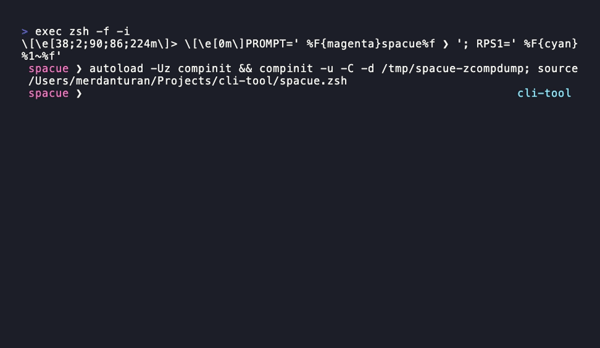

# spacue

**Inline dropdown autocomplete for zsh — one file, zero dependencies.**

Type a command, press space, and a dropdown of likely candidates appears right
under your prompt: `package.json` scripts for npm/pnpm/yarn/bun, git
subcommands and branches, Makefile targets, ssh hosts, running PIDs,
directories for `cd`, files for everything else. Arrow keys to navigate,
Enter or Tab to insert, Enter again to run, Esc to dismiss. Frequently
accepted suggestions rise to the top, with extra weight for the current folder.

<!-- ```
you:  npm ␣
      ────────────────────────────────────────────
      npm run ␣dev        vite --port 3000
      npm run ␣build      tsc -b
      npm run ␣test       vitest
      npm install   npm run   npm test   npm exec ...
``` -->
## How



## Why

Most completion tooling is either heavyweight — daemons, background services,
model hooks — or locked to a single editor. spacue is **a single ~51 KB zsh
file**: no daemon, no background process, no extra runtime to install.
It sits in your shell and makes the prompt you already use smarter.
The optional demo media in this
repository is not installed by the one-line installer.

## Install

### macOS & Linux (one line)

```sh
curl -fsSL https://raw.githubusercontent.com/merdanturan/spacue/main/install.sh | sh
```

The installer copies `spacue.zsh` to `~/.spacue/` and adds one source line to
`${ZDOTDIR:-$HOME}/.zshrc`. Updates are validated before replacing the installed
file, so a failed download leaves your current installation intact.
From then on spacue loads automatically in **every** terminal
window, including the first one after every reboot — no login item, no
background daemon, nothing to start manually.

Open a new terminal window (or run `exec zsh`) and try `cd ␣`.

### Windows (WSL)

Native PowerShell/cmd has no zsh, so spacue runs inside [WSL](https://learn.microsoft.com/windows/wsl/install):

```powershell
wsl --install                                          # one-time, then reboot
wsl sh -c "sudo apt update && sudo apt install -y zsh" # one-time
irm https://raw.githubusercontent.com/merdanturan/spacue/main/install.ps1 | iex
```

Then open a new WSL terminal. `spacue_uninstall` or `uninstall.sh` removes
everything cleanly.

### Manual

```sh
git clone https://github.com/merdanturan/spacue "$HOME/.spacue"
echo 'source "$HOME/.spacue/spacue.zsh"' >> "${ZDOTDIR:-$HOME}/.zshrc"
```

### Plugin managers

```sh
antigen bundle merdanturan/spacue
zinit light merdanturan/spacue                       # zinit
git clone https://github.com/merdanturan/spacue \
  ~/.oh-my-zsh/custom/plugins/spacue                 # oh-my-zsh, then: plugins+=(spacue)
```

## Usage

| Key                | Action                                        |
|--------------------|-----------------------------------------------|
| `space`            | open the menu after a command                 |
| `↑` `↓`            | move the selection                            |
| `Enter` / `Tab`    | accept the selected item (does **not** run)   |
| `Enter` (again)    | run the line                                  |
| `Esc` / `Ctrl+G`   | close the menu, keep what you typed           |
| keep typing        | live-filter while the menu is open            |

What shows up per command:

| Command                                  | Candidates                                    |
|------------------------------------------|-----------------------------------------------|
| `npm` / `pnpm` / `yarn` / `bun`          | `package.json` scripts (with the real command as hint) + subcommands; dependencies for `install`/`add` |
| `git`                                    | subcommands; branches & changed files per subcommand; remotes for push/pull |
| `make`                                   | Makefile targets (`## comment` shown as hint) |
| `ssh` / `scp` / `sftp`                   | hosts from `~/.ssh/config` + `known_hosts`    |
| `kill` / `killall` / `pkill`             | running PIDs / process names                  |
| `cd` / `pushd`                           | directories (including `../`)                 |
| `ls`, `cat`, `vim`, `code`, `grep`, ...  | files & directories                           |
| `ls -`, `curl -`, `git commit -`, ...    | common flags                                  |
| anything else                            | files & directories, including later arguments |
| `sudo` / `env` / `time` / `command` ...  | the wrapped command's own candidates          |

Fuzzy fallback: `npm run bi␣` still finds `build`.

Built-in providers supply command-specific suggestions for the commands above.
Other commands receive file suggestions; spacue does not bundle a full CLI
specification catalog. Plain Tab outside a spacue menu still uses your installed
zsh completions. Commands after `|`, `&&`, `||`, and `;` use their own provider.

## Configuration

Set these before spacue loads (or export them in `~/.zshrc`):

| Variable                 | Default | Meaning                                            |
|--------------------------|---------|----------------------------------------------------|
| `SPACUE_ENABLED`         | `1`     | master kill switch                                 |
| `SPACUE_HINTS`           | `1`     | show descriptions next to items                    |
| `SPACUE_GENERIC`         | `1`     | file candidates for unknown commands               |
| `SPACUE_NATIVE`          | `0`     | opt in to installed zsh completions for other commands |
| `SPACUE_FUZZY`           | `1`     | substring fallback when prefix matching is empty   |
| `SPACUE_TYPING_TRIGGER`  | `1`     | reopen the menu while typing after `dir/`          |
| `SPACUE_COMPINIT`        | `1`     | auto-load compinit when your setup lacks it        |
| `SPACUE_DISABLED`        | `()`    | providers to turn off, e.g. `SPACUE_DISABLED="ssh kill"` |
| `SPACUE_MAX`             | `200`   | max candidates in spacue's own provider menus       |
| `SPACUE_STATS`           | `1`     | rank by accepted suggestions; `0` disables reads and writes |
| `SPACUE_STATS_FILE`      | `${XDG_CACHE_HOME:-$HOME/.cache}/spacue/stats.tsv` | local usage file |

## Native completions (opt-in)

To use installed zsh completion definitions for commands without a spacue
provider, set this before loading spacue:

```zsh
SPACUE_NATIVE=1
```

For example, `docker ␣` can use an already installed `_docker` definition.
Spacue does not install completion definitions or the commands themselves.
Built-in providers, registered custom providers and the existing path-command
behavior retain precedence. If a native definition produces no matches, the
ordinary file fallback is used when `SPACUE_GENERIC=1`.

Native groups retain zsh's filtering, ordering, descriptions, quoting and suffix
rules. They are not usage-ranked or subject to spacue's candidate cap; those
features continue to apply to spacue's own candidates. Enter/Tab acceptance and
Esc/Ctrl-G dismissal work the same way. Plain Tab remains unchanged.

This is disabled by default for compatibility. Like pressing stock Tab, calling
an installed completion function can execute programs and its latency depends
on that function. Set `SPACUE_NATIVE=0` to return to file-only fallback.

## Local ranking

Selections accepted with Enter or Tab are counted immediately, in the directory
where they were accepted. Merely previewing, typing, or dismissing a suggestion
does not count. The score is **global frequency + 2 × current-directory
frequency**; ties keep the provider's original order. Package scripts share
their counts between `npm ␣` and `npm run ␣` (likewise for other package managers).

The file uses TSV (`command:candidate`, count, directory) rather than JSON/TOML
so zsh can read it without an extra parser. An empty directory field holds a
global count. Records are capped at 8,000; writes use a lock and atomic rename
to protect updates from multiple terminals. File permissions are private to
your user. No command history, script body, or telemetry is collected; the file
contains accepted candidate names and directory paths. Names with tabs or
newlines are not recorded.

Set `SPACUE_STATS=0` to opt out. Remove the stats file to reset ranking, or set
`SPACUE_STATS_FILE` to a different path. Uninstalling the plugin preserves this
usage file; remove it separately to delete your learned rankings.

Parsed counts are cached in memory. Atomic updates from other terminals,
directory/file changes and the next prompt invalidate that cache. Within an
active menu, built-in provider candidates are reused before filtering and
before the display limit; new interactions refresh them. Custom providers
continue to run for every filter update.

## Custom providers

A provider is a zsh function that receives `(cmd token args...)`, appends
candidates with `spacue_add VALUE [DESC] [MATCH]`, and optionally sets
`SPACUE_KIND` to `words` or `paths`:

```zsh
# ~/.zshrc, after spacue loads
spacue_register docker _my_docker
_my_docker() {
  local cmd=$1 token=$2 sub=$3
  SPACUE_KIND=words
  case $sub in
    ('') for s in run build ps images pull push logs exec compose; do
           spacue_add "$s"
         done ;;
  esac
}
```

## FAQ

**Does it need macOS Login Items or a startup daemon?**
No — and it can't be one. A Login Item (or LaunchAgent) is for *processes* the
system starts at boot. spacue is not a process; it is code that runs inside
every zsh session. The `source` line in `~/.zshrc` is the persistence
mechanism: every shell you open — first thing after a reboot included — loads
it automatically. If spacue ever ran a daemon instead, it *would* show up as a
background item — which is exactly the kind of hidden baggage this tool exists
to avoid.

**Does it slow down my prompt?** Candidates are computed on demand and cached
(`git` 3 s, `ssh` 10 s, `ps` 2 s TTLs). If your shell has not loaded the zsh
completion system, spacue initializes it once; `SPACUE_COMPINIT=0` opts out.

**Does it break Tab?** Plain `Tab` keeps zsh's standard completion. While a
spacue suggestion is active, Tab accepts it just like Enter. Previous key
bindings are restored when the suggestion is accepted or dismissed.

**Known conflicts:** `fzf-tab` replaces the same menu machinery, so don't load
both.

## Compatibility

Requires zsh with its standard `complist`, `stat`, `system`, and `files` modules
(included with macOS and typical Linux/WSL zsh packages). Tested locally on
zsh 5.9. The JSON reader
for `package.json` prefers `node`, then `jq`, then `python3`, and finally falls
back to pure awk — no hard dependency.

## Development

Tests drive a real pty running zsh and assert on the rendered screen, plus
isolated cache, ranking, concurrency, quoting, and installer regressions.
No Python packages are needed:

```sh
python3 tests/run.py        # run the maintained suites sequentially
python3 tests/regression.py # fast non-PTY regressions
python3 tests/test_ui.py    # acceptance and quoting regressions
python3 tests/test_native.py # installed completion integration
python3 tests/benchmark.py   # warm filtering, synthetic large-directory workload
```

The benchmark uses 200 package scripts, 5,000 directories and 8,000 ranking
records. `--plugin /path/to/spacue.zsh` runs the same workload against another
version. Timings are measurements, not test thresholds; run benchmarks separately
from the test suites for a useful comparison.

[Recorded comparison and methodology](docs/performance.md).

The older `diag*.py` files outside the runner are exploratory diagnostics,
not additional release checks. The maintained PTY suites share fixtures and
must not be run in parallel.

## License

[MIT](LICENSE)
